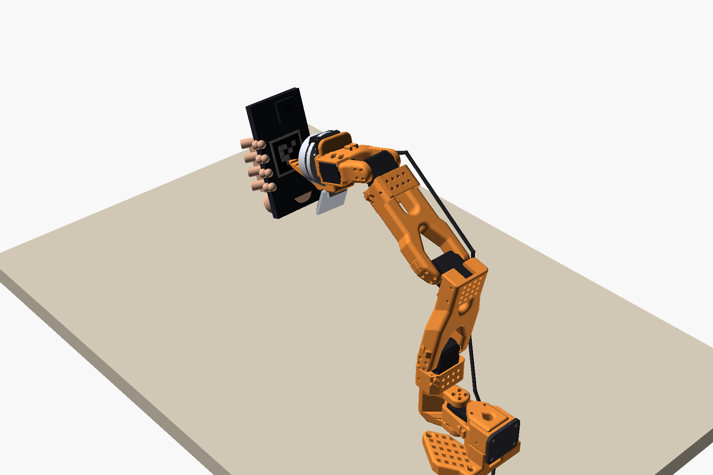

# SO-101 桌面机械臂 · Qi 无线充电跟随站

用一台 SO-101 桌面臂把 15W Qi 充电盘送到手机背面，并通过腕部相机跟随手持的手机移动。
你举着手机在臂前方移动，臂保持 60mm 悬停；手机停稳 0.8s 后自动贴近充电，拿起手机则立即退回。



> **状态**：设计阶段。代码已通过合成 ArUco 与状态机测试，**尚未在实机上验证**。
> 机械臂套件、相机、Qi 模块都还没买，详见 [硬件清单](#硬件清单)。

## 方案

- **臂**：SO-101 从臂（6× Feetech STS3215 12V），去掉夹爪，换成自定义末端
- **末端**：Ø60 盘体 + 15W Qi 模块 + 4× N35 磁铁 + 3 点弹簧浮动 + 32×32 全局快门相机
- **吸附**：手机靠磁铁吸在盘上免手持充电；盘体带挂绳耳，挂绳做防坠兜底，CARRY 模式持续检测相对位姿
- **搬运**：吸附稳定后按平滑轨迹把手机送到指定位置（默认 80mm/s），全程监测滑动
- **两种模式**：默认手持跟随（60mm 悬停）；运行中按 `c` 切到磁吸免手持，按 `t` 手动搬运
- **视觉**：手机背面贴 40mm ArUco（DICT_4X4_50 / id 0），中心对准手机线圈；`solvePnP` 出位姿，手眼标定转到基座系
- **朝向**：竖放、横放都能充——盘是圆的，线圈和磁环旋转对称；横放时贴合距离自动从 3mm 放到 6mm
- **控制**：60Hz 位置型视觉伺服，`FOLLOW → APPROACH → CHARGE → RELEASE` 状态机，Placo 逆解
- **自由度**：位置 3 + 法向 2 = 5，圆形线圈的自转不影响充电，所以臂上不加俯仰舵机

```
相机 60fps → ArUco → solvePnP → 手眼变换 → α-β 滤波 → 目标位姿
         → P 控制 + 速度前馈 → IK → 总线舵机
```

## 仓库结构

```
desk-charger/
├── tracker.py      ArUco 检测、位姿解算、滤波与预测
├── calib.py        相机内参 / 手眼标定 / 贴合示教
├── follow.py       跟随控制器、状态机、安全约束
│   └── arm.py      SO-101 后端（LeRobot + Placo）与 MockArm
├── config.yaml     全部可调参数
├── mech/
│   ├── ee.scad     末端参数化模型（改顶部变量重新导出）
│   ├── plate.stl   腕接板 + 相机架
│   ├── puck.stl    盘体（线圈仓、磁铁孔、热熔螺母孔）
│   ├── foam.stl    泡棉环切割模板
│   └── preview_*.png
└── requirements.txt
```

## 快速开始

### 1. 依赖

```bash
pip install -r requirements.txt
pip install "lerobot[placo-dep]"        # 机械臂后端
```

需要 Python ≥ 3.10。OpenCV 5 的 Python 绑定没有 `calibrateHandEye`，`calib.py` 内置了 Park 法实现，不依赖它。

### 2. 模型与打印

从 [SO-ARM100](https://github.com/TheRobotStudio/SO-ARM100) 下载臂的 URDF 和打印件：

```
urdf/so101_new_calib.urdf   ← Simulation/SO101/so101_new_calib.urdf
```

末端用本仓库的 STL，PETG、0.2mm、4 壁、25% 填充；M2.5 用热熔螺母。
`ee.scad` 顶部的腕部孔距默认 40×40，**打印前按实物测量修改**。

```bash
openscad -D 'PART="plate"' -o plate.stl --export-format binstl mech/ee.scad
openscad -D 'PART="puck"'  -o puck.stl  --export-format binstl mech/ee.scad
```

### 3. 标定

```bash
python calib.py intrinsics --images calib_data/chess     # 棋盘格内参
python calib.py capture                                 # 固定标记，摆 15–20 个姿态
python calib.py handeye                                 # 解 T_ee_cam，看散布 < 3mm
python calib.py dock                                    # 手动把盘贴到手机，示教贴合位姿
python calib.py deliver                                 # 可选：示教送达位姿（吸附后搬到的位置）
```

输出写到 `calib/`，该目录里的 yaml 已被 gitignore。

### 4. 运行

```bash
python follow.py --mock          # 无硬件，看状态机
python follow.py                 # 实机
```

Windows 上把 `config.yaml` 的 `arm.port` 改成实际 COM 口（如 `COM5`），相机索引从 0 试起。

## 关键参数（config.yaml）

| 参数 | 默认 | 说明 |
|---|---|---|
| `puck.hover_mm` | 60 | 跟随时盘面到手机的距离，给 100ms 延迟留余量 |
| `puck.contact_mm` | 3 | 竖放时的贴合距离，靠泡棉和弹簧吸收 |
| `puck.contact_mm_rotated` | 6 | 横放时的贴合距离，给手机长边和腕部相机留间隙 |
| `puck.rotated_axis_cos` | 0.87 | 手机长轴与相机侧夹角 <30° 时判为横放 |
| `carry.enabled` | true | 停稳后自动吸附；false 只跟随不吸附 |
| `carry.gap_mm` | 1.0 | 吸附时盘面到手机 |
| `carry.slip_mm` / `slip_deg` | 3 / 5 | 相对位姿漂移超过就断电回退 |
| `transport.enabled` | true | 吸附后自动搬运 |
| `transport.speed_mm_s` | 80 | 搬运速度，平滑加速/减速 |
| `transport.delay_s` | 1.5 | 吸附稳定后等待确认手已松开 |
| `transport.deliver_mm` | [300,-120,220] | 末端送达点；有 `calib/deliver.yaml` 时以文件为准 |
| `puck.approach_mm_s` | 30 | 贴合段速度 |
| `control.hz` | 60 | 控制频率 |
| `control.vmax_mm_s` | 250 | 末端限速 |
| `state.settle_time_s` | 0.8 | 静止多久后开始贴近 |
| `state.release_speed_mm_s` | 25 | 超过这个速度立即退回 |
| `camera` / `marker` | — | 分辨率、ArUco 字典与 40mm 边长 |

## 状态机

| 状态 | 行为 | 退出条件 |
|---|---|---|
| `FOLLOW` | 悬停 60mm 跟随 | 静止 0.8s → APPROACH；丢失 0.3s → RETRACT |
| `APPROACH` | 以 30mm/s 降到 3mm | 到位且稳定 0.3s → CHARGE；手机动了 → FOLLOW |
| `CARRY` | 手机吸在盘上，保持 1mm，Qi 常开 | 相对位姿滑动 >3mm/5° → RETRACT；手机被取下同样触发 |
| `TRANSPORT` | 平滑曲线搬到送达位姿，Qi 常开 | 到位 → CARRY；滑动或丢标记 → RETRACT |
| `CHARGE` | 非吸附模式：打开 Qi，监控功率 | 位移 > 5mm 或速度 > 25mm/s → RELEASE |
| `RELEASE` | 退回 60mm | 到位 → FOLLOW |
| `RETRACT` | 沿法向退 100mm | 到位 → IDLE |

## 跟随 + 吸附（默认自动流转）

| 场景 | 行为 |
|---|---|
| 你拿着手机移动 | 60mm 悬停跟随；停稳 0.8s 后自动贴近并吸附 |
| 已吸附 | 1mm 保持、Qi 常开；按 `t` 可搬到送达点 |
| 拿走手机 | 按 `c` 释放：关 Qi、退回，随后恢复跟随 |

吸到 1mm 后腕部相机基本看不到标记，这是正常的：此阶段不再依赖视觉，丢标记不会中断充电，防坠靠挂绳。想只用跟随、不吸附，把 `carry.enabled` 设为 false。

运行窗口快捷键：`c` 释放/切换吸附，`t` 手动搬运，`esc` 退出。

## 竖放 / 横放

- 充电本身与朝向无关：Qi 线圈和磁环都是旋转对称的，标记又在圆心，手机转 90° 不影响能量传输
- 打印标记时**上边朝向手机顶部**贴好，程序靠它判断横竖；贴歪了最多退回竖放判断，机械上仍有约 3mm 间隙
- 竖放贴合 3mm；横放自动放到 6mm，避免手机长边靠近腕部相机
- 横放时手指尽量捏短边，别挡住背面中心的标记
- CARRY 吸附时统一用 1mm 间距，不分横竖；横竖只影响接近阶段留多少余量

## 硬件清单

| 模块 | 关键件 |
|---|---|
| 机械臂 | SO-101 从臂（6× STS3215 12V）、USB 总线板、12V 5A+ 电源、桌面夹具 |
| 末端 | plate/puck/foam、15W 12V Qi 模块（带 FOD）、4× N35 Ø5×3、3× M2.5 肩螺丝（肩长 10–12）、3× Ø4×8 弹簧、M2.5 热熔螺母、3mm EVA、15cm 防坠挂绳 |
| 视觉 | OV9281 全局快门 32×32 USB 模块、USB 集线器、补光 |
| 电控 | USB 继电器（Qi 通断）、12V 急停、5A 保险丝 |
| 手机侧 | MagSafe 磁吸壳（或整圈金属环，别用四片引磁片）、挂绳挂点、40mm ArUco 贴纸（黑色外边正好 40mm） |

## 安全

- 急停串在舵机电源上，不要只做软件停
- 吸附靠磁铁 + 挂绳双保险：磁铁负责贴合，挂绳负责万一磁铁剥离时手机不落地
- 标记可见时，CARRY 持续比较"手机相对盘"的位姿，滑动超过 3mm / 5° 立刻关 Qi 并沿法向退回
- 吸到 1mm 后相机看不到标记，视觉监测自动跳过；这段时间的防坠完全依赖挂绳
- 搬运默认 80mm/s，使用平滑加减速；送达点会被限制在工作空间内
- 工作空间限制在底座前方 150–350mm、高度 0–300mm
- 手进入工作区时不要下降：可用 ToF 或简单的视觉遮挡检测
- Qi 模块必须有 FOD，金属钥匙落在盘上会拒充

## 已验证 / 未验证

已验证：

- 合成 ArUco：300mm 距离位置误差 2.31mm、角度 0.21°
- 标记旋转 90°：目标中心不变，手机长轴方向正确旋转
- 竖放/横放：mock 状态机分别在 3mm / 6mm 进入 CHARGE，Qi 正常使能
- CARRY：吸附后 1mm 保持、Qi 开启；模拟手机相对盘滑移 5mm 后 0.0s 内断电并回退 100mm
- TRANSPORT：mock 完整走出 ATTACH → TRANSPORT → CARRY，搬运途中注入 5mm 滑移会立即中断并回退
- 两种模式：mock 分别走出 FOLLOW→APPROACH→CHARGE→RELEASE→FOLLOW 和 CARRY→TRANSPORT→CARRY
- 吸附中标记消失 1.5s：保持 CARRY、Qi 不断，按 `c` 后正常释放
- 手眼 Park 解法：无噪声 0.0mm，0.5mm 噪声下 0.14mm
- 状态机全流程与丢目标回退（mock）

未验证：

- LeRobot 总线、真实手眼标定、Qi 充电
- 末端尚未实机打印与装配

## 许可证

代码与模型以 [MIT](LICENSE) 发布。机械臂设计来自 [TheRobotStudio/SO-ARM100](https://github.com/TheRobotStudio/SO-ARM100)（Apache-2.0），软件栈使用 [HuggingFace LeRobot](https://github.com/huggingface/lerobot)（Apache-2.0）与 OpenCV（Apache-2.0）。本仓库不包含上述项目的源文件，URDF 需自行下载。

## 致谢

SO-ARM100 / SO-101 由 The Robot Studio 与 Hugging Face 设计；渲染图使用官方 URDF 网格在 OpenSCAD 中生成。
